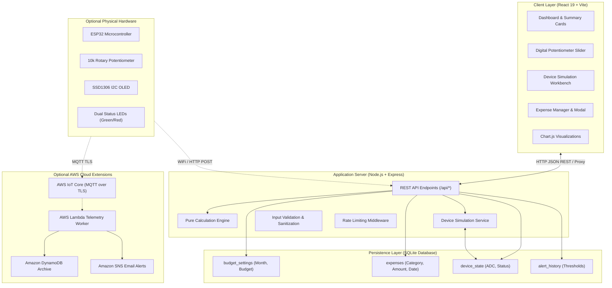

# Architecture Specification

## 1. System Overview

The **Budget Planner Physical Slider** is a cyber-physical financial simulation platform. It bridges physical hardware principles (ESP32 ADC potentiometer, status LEDs, and SSD1306 OLED screen) with modern full-stack web technologies and optional AWS cloud integration.

---

## 2. Component Design

### A. Digital Potentiometer Slider & ADC Mapping
- Physical potentiometers provide a variable analog voltage between $0\text{V}$ and $3.3\text{V}$.
- The ESP32's internal Successive Approximation Register (SAR) ADC converts this voltage into a 12-bit digital integer between $0$ and $4095$.
- The calculation engine maps the ADC value linearly to an Indian Rupee budget between ₹0 and ₹50,000:
$$\text{Budget} = \text{round}\left(\frac{\text{ADC}}{4095} \times 50000\right)$$

### B. Budget Calculation Engine
- **Total Expenses**: $\sum \text{amount}_i$ for all approved records in selected month.
- **Remaining Balance**: $\text{Monthly Budget} - \text{Total Expenses}$.
- **Utilization Percentage**: $\left(\frac{\text{Total Expenses}}{\text{Monthly Budget}}\right) \times 100$ (handles 0 budget safely).
- **Evaluation Rules**:
  - `Good` (Green LED ON, Red LED OFF): Utilization $< 75\%$
  - `Warning` (Green LED ON, Red LED OFF): $75\% \le \text{Utilization} < 90\%$
  - `Critical` (Green LED ON, Red LED OFF): $90\% \le \text{Utilization} < 100\%$
  - `Exceeded` (Green LED OFF, Red LED ON): $\text{Utilization} \ge 100\%$

---

## 3. Database Layer

Utilizes high-performance SQLite with Write-Ahead Logging (`WAL`) mode enabled. Schema is structured with foreign keys, checks, and indexed lookups for immediate query responses under sub-millisecond latency.
